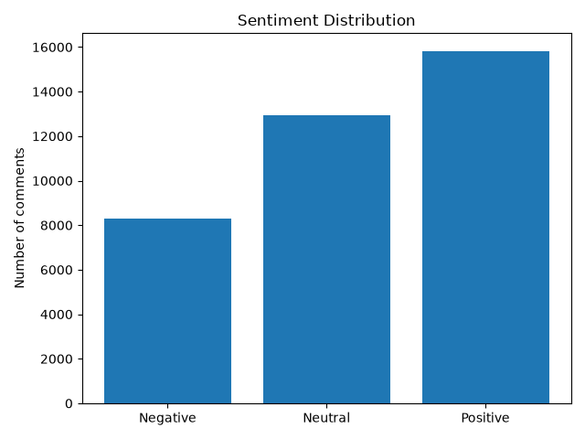
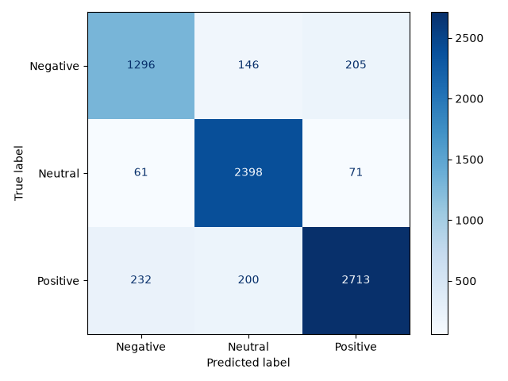

# YouTube Sentiment Analyzer

**TP3 : Analyse de sentiment YouTube, du développement au déploiement cloud**

Application de classification automatique des commentaires YouTube en trois catégories : **positif, neutre et négatif**. Elle combine une extension Chrome, une API FastAPI et un modèle de machine learning exécuté dans Docker, localement ou dans GitHub Codespaces.

## 1. Fonctionnement

```text
Vidéo YouTube
    ↓
Extension Chrome : extraction des commentaires chargés
    ↓
API FastAPI : POST /predict_batch
    ↓
TF-IDF + régression logistique
    ↓
Prédictions, scores de confiance et statistiques
    ↓
Interface de l'extension
```

L'analyse est lancée à la demande. Seuls les commentaires déjà chargés sur la page sont extraits.

## 2. Technologies

| Composant | Technologie |
|---|---|
| Modèle ML | Python 3.11, scikit-learn, TF-IDF, régression logistique |
| API | FastAPI, Pydantic, Uvicorn |
| Extension | JavaScript, HTML, CSS, Chrome Manifest V3 |
| Conteneurisation | Docker |
| Cloud | GitHub Codespaces |
| Tests et versioning | Pytest, Git, GitHub |

## 3. Données et performances

Corpus : [Reddit Sentiment Analysis](https://github.com/Himanshu-1703/reddit-sentiment-analysis). Les étiquettes sont `-1` (négatif), `0` (neutre) et `1` (positif).

| Données | Effectif |
|---|---:|
| Corpus initial | 37 249 |
| Après nettoyage et déduplication | 36 607 |
| Entraînement | 29 285 |
| Test | 7 322 |

Le découpage entraînement/test est stratifié (80/20, `random_state=42`). Le modèle final utilise un vectoriseur TF-IDF (20 000 caractéristiques, unigrammes et bigrammes) et une régression logistique (`C=5`, `class_weight=balanced`, `max_iter=1000`).

| Mesure | Résultat |
|---|---:|
| Accuracy sur le test Reddit | **87,50 %** |
| F1-score macro | **0,86** |
| F1 négatif / neutre / positif | 0,80 / 0,91 / 0,88 |
| Inférence locale pour 50 commentaires | 6,65 ms en moyenne |
| Réponse HTTP locale pour 50 commentaires | 19,84 ms en moyenne (nouvelle mesure) |

La mesure HTTP historique était de 21,93 ms. Ces temps ont été mesurés localement et **ne représentent pas la latence cloud**.





## 4. Installation locale

Prérequis : **Git**, **Docker Desktop** et **Google Chrome**. Python 3.11 est nécessaire pour exécuter directement les scripts.

```bash
git clone https://github.com/Bouch-Anass/youtube-sentiment-analyzer.git
cd youtube-sentiment-analyzer
docker build -t youtube-sentiment-api .
docker run --rm -p 7860:7860 youtube-sentiment-api
```

API locale : http://127.0.0.1:7860

Documentation interactive : http://127.0.0.1:7860/docs

Pour lancer l'API directement avec Python sous Windows :

```powershell
py -3.11 -m venv .venv
.\.venv\Scripts\Activate.ps1
python -m pip install -r requirements.txt
python -m uvicorn src.api.app:app --reload
```

Cette dernière commande utilise le port **8000**.

## 5. Déploiement avec GitHub Codespaces

1. Sur le dépôt, ouvrir **Code → Codespaces** et créer ou reprendre un Codespace.
2. Dans son terminal, exécuter :

```bash
docker build -t youtube-sentiment-api .
docker run -d --name youtube-sentiment-api -p 7860:7860 youtube-sentiment-api
curl http://localhost:7860/health
```

3. Dans l'onglet **Ports**, définir la visibilité de `7860` sur **Public**.
4. Copier l'URL HTTPS générée et vérifier les routes `/health` et `/docs`.

URL utilisée lors du projet :

`https://glowing-potato-q754xg7x4vjfxq56-7860.app.github.dev`

> Codespaces n'est pas un hébergement permanent. L'API ne répond que si le Codespace et le conteneur sont actifs. Après une reprise, vérifier le port public et l'URL.

## 6. Installation et utilisation de l'extension

1. Ouvrir `chrome://extensions` et activer le **Mode développeur**.
2. Cliquer sur **Charger l'extension non empaquetée** (*Load unpacked*).
3. Sélectionner le dossier `chrome-extension/`.
4. Ouvrir une vidéo YouTube et faire défiler la page pour charger les commentaires.
5. Ouvrir **YouTube Sentiment Analyzer**, puis cliquer sur **Analyze Comments**.

L'extension affiche les proportions par sentiment, les prédictions et les scores de confiance. Elle propose des **filtres**, un **mode sombre/clair**, la **copie** des résultats et leur **export CSV**.

**Configuration de l'API :** `chrome-extension/popup.js` appelle actuellement l'URL HTTPS de Codespaces. Pour utiliser Docker en local, remplacer cette URL par `http://127.0.0.1:7860/predict_batch`, puis recharger l'extension. Les deux hôtes figurent dans `manifest.json`. Il n'y a pas de basculement automatique.

## 7. API et tests

| Route | Méthode | Rôle |
|---|---|---|
| `/health` | GET | Vérifier le démarrage de l'API et le chargement du modèle |
| `/predict_batch` | POST | Analyser une liste de commentaires et renvoyer les statistiques |
| `/docs` | GET | Accéder à la documentation interactive |

Exemple de requête :

```json
{
  "comments": [
    "This video is amazing",
    "This is terrible",
    "The video was uploaded yesterday"
  ]
}
```

Pour exécuter les tests sous Windows avec l'environnement Python activé et le conteneur local sur le port 7860 :

```powershell
python -m pytest tests/test_api.py tests/test_docker_api.py -v
```

**Résultat enregistré : 13 tests réussis** (5 tests API et 8 tests d'intégration Docker). Les tests couvrent notamment les tailles de lot, les entrées invalides et plusieurs cas limites.

**État du projet :** modèle et extension opérationnels ; déploiement local et déploiement Codespaces testés. Le Codespace doit être démarré pour utiliser l'API cloud.
